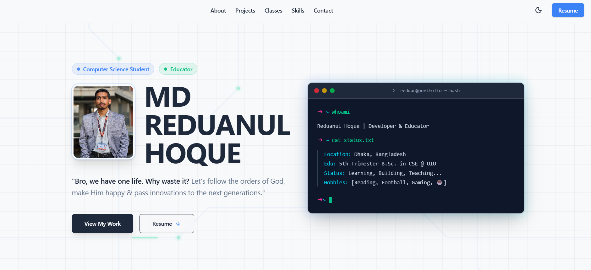
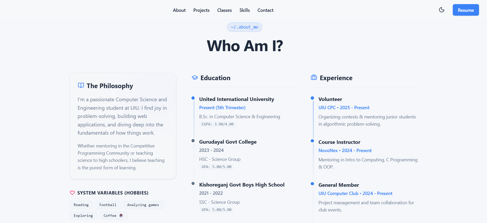
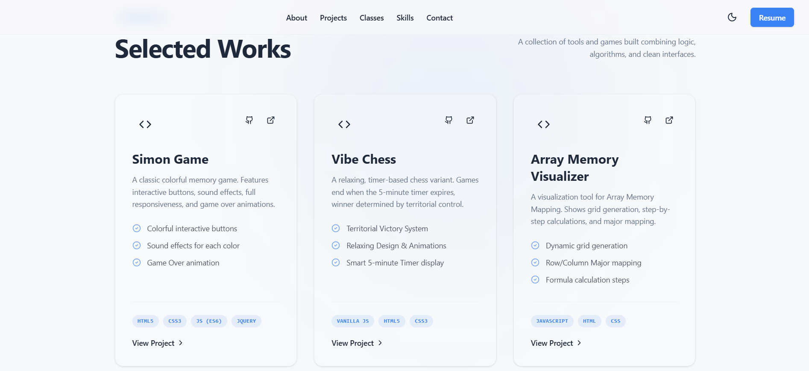

# MD REDUANUL HOQUE — Developer Portfolio & Command Center

[](https://nextjs.org/)
[](https://react.dev/)
[](https://tailwindcss.com/)
[](https://www.typescriptlang.org/)
[](https://firebase.google.com/)
[](#license)

A modern, high-performance personal portfolio, dynamic updates/blog engine, and administrative Command Center built for **MD Reduanul Hoque** — a Computer Science & Engineering student, software developer, and educator based in Dhaka, Bangladesh.

---

## 🔗 Live Deployments

- **Production URL:** [https://reduanulhoque.web.app/](https://reduanulhoque.web.app/)
- **Legacy URL (301 Permanent Redirect):** [https://portfolio-md-reduanul-hoque.web.app/](https://portfolio-md-reduanul-hoque.web.app/)

---

## 📸 Previews







---

## ✨ Features

### 🌟 Portfolio & Client Experience
- **Interactive Hero & About Section:** Dynamic bio, academic background, philosophy, hobbies, and downloadable resume.
- **Project Showcase:** Highlights key projects with live demo links, source code repositories, tech stack tags, and feature breakdowns.
- **Educational Classes Carousel:** Embedded YouTube video lectures and tutorials with an auto-scrolling carousel.
- **Terminal-Style Skills Matrix:** Categorized technical competencies and developer tools displayed with a distinctive terminal aesthetic.
- **Dynamic Profile Favicon:** Dynamically generates and syncs a rounded canvas favicon from the administrator's profile photo in real time.
- **Updates & Blog Platform (`/updates`):** Standalone publication feed and reader with estimated reading times, tag-based categorization, and responsive formatting.
- **Dark & Light Mode:** Seamless theme transitions with custom color tokens powered by `next-themes`.
- **Search Engine Optimization & Social Sharing:** Fully indexed with dynamic `sitemap.ts`, `robots.ts`, OpenGraph social preview cards, and Schema.org `Person` JSON-LD structured data.

### 🛡️ Administrative Command Center (`/admin`)
- **Protected Administration (`AdminGuard`):** Protected dashboard routes restricted to authenticated administrator sessions verified against Firebase Authentication and authorized admin UID credentials.
- **Full Content Lifecycle Management:**
  - **Profile Management:** Update bio, tagline, location, hobbies, philosophy, and profile photos.
  - **Education & Experience:** Add and manage academic records and professional roles with current-status toggles.
  - **Achievements & Awards:** Showcase competitive programming, hackathons, and academic honors.
  - **Projects Management:** Maintain project details, feature bullets, tech stacks, and live links.
  - **YouTube Classes:** Manage educational content, video IDs, and course descriptions.
  - **Updates / Blog CMS:** Compose, preview, publish, and toggle public visibility for blog posts.
  - **Social Links:** Update contact channels, social profiles, and resume URLs.
- **Real-Time Data Synchronization:** Instant updates using custom Firebase Firestore hooks (`useFirestoreCollection`, `useFirestoreDoc`).
- **Drag & Reorder Workflows:** Reorder portfolio entries via atomic Firestore batch transactions (`swapCollectionOrder`).
- **One-Click Database Seeding:** Seed Firestore with default portfolio data directly from the dashboard for instant bootstrap on fresh databases.

### 🔒 Security & Performance
- **Zero Hardcoded Secrets:** Strictly isolates credentials in local environment files (`.env.local`) and deployment configurations.
- **Robust Firestore & Storage Rules:** Server-enforced permissions restricting mutations strictly to the authorized administrator UID (`firestore.rules`, `storage.rules`).
- **Storage Constraints:** Strict upload enforcement on MIME types (`image/*`, `application/pdf`) and file size limits (5 MB for images, 10 MB for PDFs).
- **Hardened HTTP Headers:** Content Security Policy (CSP), `X-Frame-Options: DENY`, `X-Content-Type-Options: nosniff`, `Referrer-Policy: strict-origin-when-cross-origin`, `Permissions-Policy`, and HSTS configured via `firebase.json`.

---

## 🛠️ Tech Stack

| Layer | Technologies |
| :--- | :--- |
| **Framework** | [Next.js](https://nextjs.org/) 16.1.6 (App Router, Static Export `output: "export"`) |
| **UI Library** | [React](https://react.dev/) 19.2.3 |
| **Styling** | [Tailwind CSS](https://tailwindcss.com/) 4.0 (`@tailwindcss/postcss`) |
| **Language** | [TypeScript](https://www.typescriptlang.org/) 5.x |
| **Backend & Cloud** | [Firebase](https://firebase.google.com/) 12.14.0 (Authentication, Cloud Firestore, Cloud Storage, Firebase Hosting) |
| **UI Components & Icons** | [Lucide React](https://lucide.dev/), [React Hot Toast](https://react-hot-toast.com/) |
| **Theme Management** | [next-themes](https://github.com/pacocoursey/next-themes) |
| **Typography** | Google Fonts ([Lora](https://fonts.google.com/specimen/Lora) & [Inter](https://fonts.google.com/specimen/Inter)) |

---

## 📁 Project Structure

```
portfolio/
├── .agents/                      # AI operational rules and workflows
├── public/                       # Static public assets (images, previews, icons, PDF resume)
│   ├── Formal.jpg                # Profile photo fallback
│   ├── icon.png                  # Application icon
│   ├── md_reduanul_hoque_resume.pdf
│   ├── preview-1.png             # Readme preview screenshot 1
│   ├── preview-2.png             # Readme preview screenshot 2
│   └── preview-3.png             # Readme preview screenshot 3
├── src/
│   ├── app/                      # Next.js App Router
│   │   ├── admin/                # Command Center (Protected CMS routes)
│   │   │   ├── achievements/     # Achievements editor
│   │   │   ├── classes/          # Classes editor
│   │   │   ├── education/        # Education editor
│   │   │   ├── experience/       # Work experience editor
│   │   │   ├── login/            # Firebase email/password authentication
│   │   │   ├── profile/          # Profile details & image/resume uploader
│   │   │   ├── projects/         # Projects showcase editor
│   │   │   ├── skills/           # Technical skills editor
│   │   │   ├── social-links/     # Social links editor
│   │   │   ├── updates/          # Blog posts CMS
│   │   │   ├── layout.tsx        # Admin dashboard layout
│   │   │   └── page.tsx          # Admin overview & database seeding
│   │   ├── updates/              # Public updates / blog routes
│   │   │   ├── read/page.tsx     # Single post reader view
│   │   │   └── page.tsx          # Updates feed view
│   │   ├── error.tsx             # Route error boundary
│   │   ├── global-error.tsx      # Root global error boundary
│   │   ├── globals.css           # Tailwind CSS directives & theme variables
│   │   ├── layout.tsx            # Root layout with SEO, JSON-LD, Providers
│   │   ├── not-found.tsx         # Custom 404 page
│   │   ├── page.tsx              # Main portfolio single-page application
│   │   ├── robots.ts             # Dynamic robots.txt configuration
│   │   └── sitemap.ts            # Dynamic sitemap.xml generator
│   ├── components/               # Modular presentation components
│   │   ├── admin/                # Admin navigation & route guards
│   │   ├── blog/                 # Blog post formatting & rendering
│   │   ├── sections/             # Portfolio sections (hero, about, projects, skills, etc.)
│   │   ├── ui/                   # Reusable UI primitives (e.g., auto-scroll carousel)
│   │   ├── footer.tsx            # Main application footer
│   │   ├── navbar.tsx            # Dynamic navigation bar & live favicon generator
│   │   ├── theme-provider.tsx    # Theme context provider
│   │   └── theme-toggle.tsx      # Dark/light theme switcher
│   ├── hooks/                    # Custom React hooks
│   │   ├── useFirestoreCollection.ts # Real-time Firestore collection listener
│   │   └── useFirestoreDoc.ts        # Real-time Firestore document listener
│   └── lib/                      # Business logic, configuration & data
│       ├── auth-context.tsx      # Firebase auth provider & state observer
│       ├── data.ts               # Data types, Firestore operations & default fallbacks
│       └── firebase.ts           # Firebase client SDK initialization
├── .env.example                  # Environment variable template
├── firebase.json                 # Firebase Hosting, headers & redirect rules
├── firestore.rules               # Cloud Firestore security rules
├── next.config.ts                # Next.js configuration (static export, remote images)
├── package.json                  # Project manifest, scripts, and dependencies
├── storage.rules                 # Cloud Storage security rules
└── tsconfig.json                 # TypeScript compiler configuration
```

---

## 🚀 Getting Started

### Prerequisites

- **Node.js:** `v18.18.0` or higher (Node.js 20+ LTS recommended)
- **Package Manager:** `npm`, `pnpm`, `yarn`, or `bun`
- **Firebase CLI:** Optional, for deploying security rules and hosting (`npm install -g firebase-tools`)

### 1. Clone the Repository

```bash
git clone https://github.com/mdreduanulhoque/portfolio.git
cd portfolio
```

### 2. Install Dependencies

```bash
npm install
```

### 3. Configure Environment Variables

Create a `.env.local` file in the root directory by copying the template:

```bash
cp .env.example .env.local
```

Populate the variables with your Firebase project credentials:

```ini
# Firebase Client Configuration (Public Browser Bundle Keys)
NEXT_PUBLIC_FIREBASE_API_KEY=your_firebase_api_key
NEXT_PUBLIC_FIREBASE_AUTH_DOMAIN=your_project_id.firebaseapp.com
NEXT_PUBLIC_FIREBASE_PROJECT_ID=your_project_id
NEXT_PUBLIC_FIREBASE_STORAGE_BUCKET=your_project_id.firebasestorage.app
NEXT_PUBLIC_FIREBASE_MESSAGING_SENDER_ID=your_messaging_sender_id
NEXT_PUBLIC_FIREBASE_APP_ID=your_firebase_app_id

# Admin Authorization (Firebase Auth UID of the single authorized administrator)
NEXT_PUBLIC_ADMIN_UID=your_admin_firebase_uid
```

> **Note:** Update the admin UID check in `firestore.rules` and `storage.rules` to match `NEXT_PUBLIC_ADMIN_UID` before deploying security rules.

### 4. Run the Development Server

```bash
npm run dev
```

Visit [http://localhost:3000](http://localhost:3000) in your browser to view the application.

---

## 📜 Available Scripts

| Script | Command | Description |
| :--- | :--- | :--- |
| **Development** | `npm run dev` | Runs the Next.js local development server with Turbopack/HMR. |
| **Build** | `npm run build` | Compiles the production application and exports static HTML/CSS/JS to `out/`. |
| **Preview** | `npm run start` | Starts a Next.js production server. |
| **Lint** | `npm run lint` | Runs ESLint 9 across all TypeScript and React source files. |
| **Deploy All** | `npm run deploy` | Builds the static export and deploys both rules and hosting to Firebase. |
| **Deploy Hosting** | `npm run deploy:hosting` | Builds the static export and deploys only the hosting site to Firebase. |

---

## 🚢 Production Build & Deployment

This project utilizes Next.js Static Export (`output: "export"`), generating an optimized static build in the `out/` directory.

### Building Locally

```bash
npm run build
```

The resulting assets in `out/` can be hosted on any static hosting platform.

### Deploying to Firebase Hosting

1. Log in to Firebase:
   ```bash
   firebase login
   ```
2. Deploy hosting and rules:
   ```bash
   npm run deploy
   ```
   Or deploy hosting only:
   ```bash
   npm run deploy:hosting
   ```

---

## 📬 Contact & Connect

- **Email:** [mdreduanulhoquesadik@gmail.com](mailto:mdreduanulhoquesadik@gmail.com)
- **LinkedIn:** [MD Reduanul Hoque](https://www.linkedin.com/in/md-reduanul-hoque-/)
- **GitHub:** [@mdreduanulhoque](https://github.com/mdreduanulhoque)
- **Facebook:** [reduan.sadik.9](https://www.facebook.com/reduan.sadik.9)

---

## 📄 License

This repository and its contents are for personal portfolio and demonstration purposes. All rights reserved &copy; **MD REDUANUL HOQUE**.
